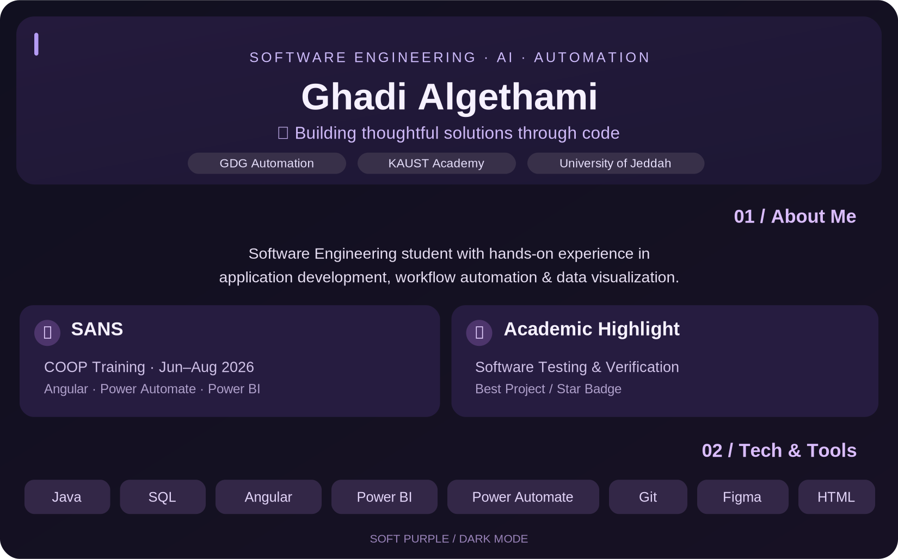

### Hi, I'm Ghadi! 💜

**Software Engineering Student @ University of Jeddah**  
Interested in building thoughtful solutions through software, AI and automation.

### ✦ More About Me

- 🎓 **B.Sc. Software Engineering**, University of Jeddah · Expected 2027
- 💼 **Former COOP Trainee at Saudi Air Navigation Services (SANS)** — contributed to Angular applications, Power Automate workflows, SharePoint improvements and Power BI dashboards
- 🤖 **KAUST Academy** — pursuing an Artificial Intelligence Specialization
- 💜 **Google Developer Groups** — Automation Team Member
- 🛠️ **Core skills:** Java, SQL, JavaScript, HTML/CSS, C/C++, Git, UML and database design

### ✦ Projects

| Project | What I worked on |
| --- | --- |
| **Task Management System** | A Java task manager using object-oriented programming concepts |
| **Gym Management System** | ER diagrams, relational schema and UML system design |
| **IoT Traffic Control System** | Sensor-based traffic control concepts and cloud monitoring |

### ✦ Explore My GitHub

[CLI ToDo / Testing Project](https://github.com/ghadialgethami/CLI-ToDo_TestingProject) · [GitHub API](https://github.com/ghadialgethami/GitHubAPI) · [Code Translations](https://github.com/ghadialgethami/Code_Translations)

---

*Learning, building, and growing — one project at a time.* ✦

